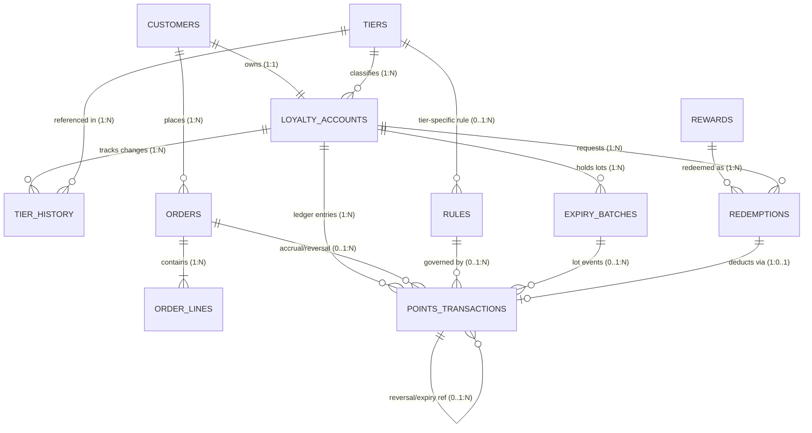

# Entity Relationship Diagram & Lifecycle States

## 1. Mermaid Entity Relationship Diagram

## 2. Relationship Cardinality Matrix

| Parent Entity | Child Entity | Cardinality | Foreign Key | Business Meaning |
|---|---|---|---|---|
| `customers` | `loyalty_accounts` | `1 : 1` | `loyalty_accounts.customer_id` | Every customer has exactly one unique loyalty account (`LOY-CUST-XXXXXX`). |
| `tiers` | `loyalty_accounts` | `1 : N` | `loyalty_accounts.tier_id` | Each account currently belongs to one active membership tier. |
| `loyalty_accounts` | `tier_history` | `1 : N` | `tier_history.account_id` | Audit log of initial enrollment, upgrades, and return-driven downgrades. |
| `customers` | `orders` | `1 : N` | `orders.customer_id` | A customer can place multiple retail orders over time. |
| `orders` | `order_lines` | `1 : N` | `order_lines.order_id` | An order consists of one or more product line items with item-level eligibility. |
| `loyalty_accounts` | `points_transactions` | `1 : N` | `points_transactions.account_id` | Append-only ledger tracking every point credit and debit. |
| `orders` | `points_transactions` | `1 : N` | `points_transactions.order_id` | Links an order to its accrual and any subsequent partial/full reversal entries. |
| `rewards` | `redemptions` | `1 : N` | `redemptions.reward_id` | Multiple redemption requests can target the same catalog reward. |
| `loyalty_accounts` | `redemptions` | `1 : N` | `redemptions.account_id` | Tracks both `COMPLETED` and `REJECTED` redemption attempts per account. |
| `redemptions` | `points_transactions` | `1 : 0..1` | `points_transactions.redemption_id` | Completed redemptions create one ledger debit; rejected ones create zero debit. |
| `loyalty_accounts` | `expiry_batches` | `1 : N` | `expiry_batches.account_id` | Tracks FIFO points lots and their remaining unspent points before expiry. |
| `expiry_batches` | `points_transactions` | `1 : N` | `points_transactions.expiry_batch_id` | Links accruals, reversals, and expiration entries to the affected points lot. |
| `rules` | `points_transactions` | `1 : N` | `points_transactions.rule_id` | Records which effective earning or expiration rule governed the transaction. |

## 3. Entity Lifecycle States

- **Customer**: `ACTIVE` -> `INACTIVE` / `SUSPENDED`
- **LoyaltyAccount**: `ACTIVE` -> `FROZEN` / `CLOSED`
- **Rule**: `ACTIVE` (between `effective_from` and `effective_to`) <-> `INACTIVE`
- **Order**: `PENDING` -> `COMPLETED` -> `PARTIALLY_RETURNED` -> `RETURNED` (or `CANCELLED`)
- **OrderLine**: `FULFILLED` -> `PARTIALLY_RETURNED` -> `RETURNED`
- **Redemption**: `PENDING` -> `COMPLETED` | `REJECTED` | `CANCELLED`
- **ExpiryBatch**: `ACTIVE` -> `PARTIALLY_CONSUMED` -> `CONSUMED` | `EXPIRED`
- **PointsTransaction**: `POSTED` (immutable append-only) | `REJECTED` | `VOIDED`

